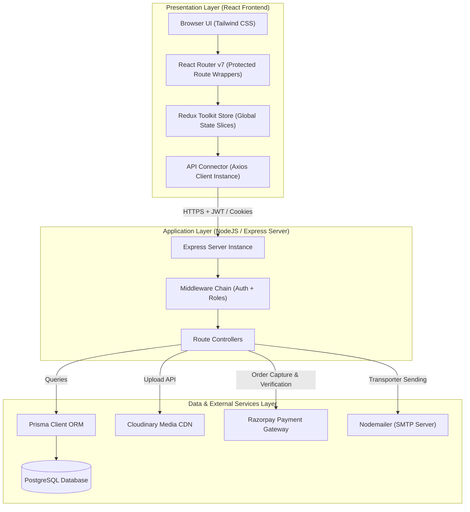
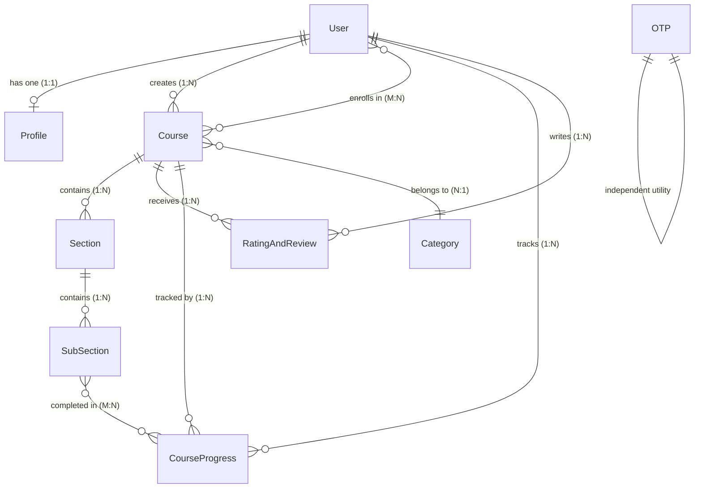
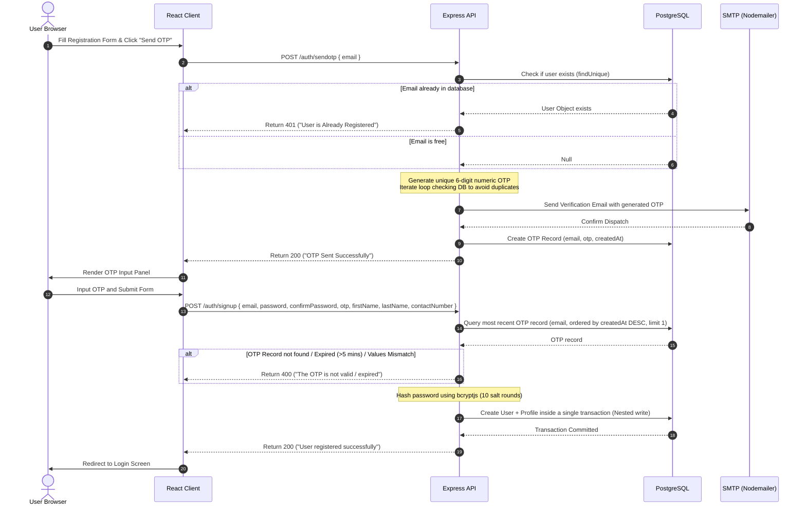
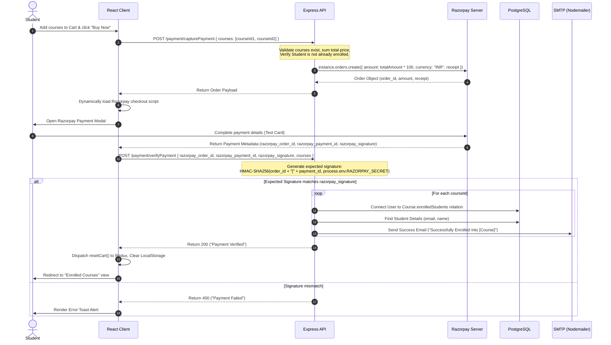
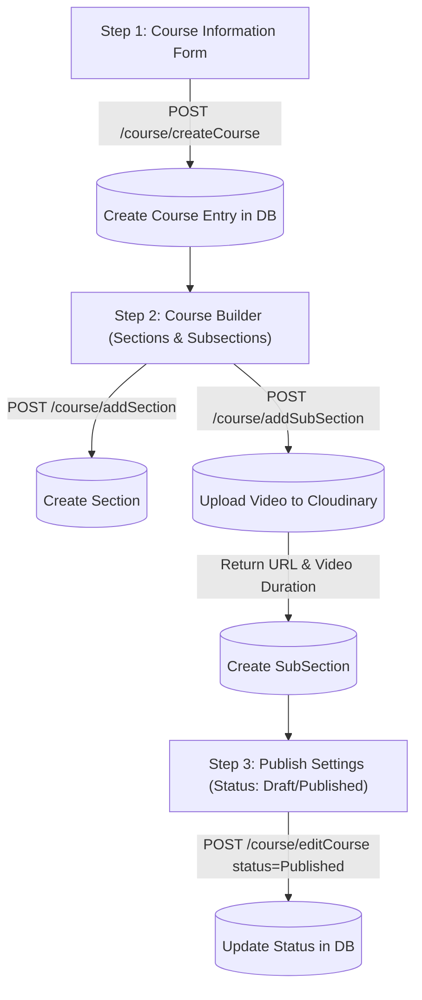

# 📚 StudyNotion — High-Level Design (HLD) Document

This document details the system design, database architecture, and transactional workflows of **StudyNotion**, a robust, scalable, full-stack e-learning platform. This HLD acts as a comprehensive reference to understand the interaction between the React frontend, Node.js/Express backend, PostgreSQL database, and third-party integrations (Razorpay, Cloudinary, and Nodemailer).

---

## 1. System Overview & Value Proposition

**StudyNotion** is a MERN-turned-PERN stack ed-tech platform built to replicate key functionalities of Udemy. It facilitates three distinct roles, each interacting with a dedicated subsystem:

* **Students:** Browse categorized catalogs, manage a shopping cart, buy courses securely using the Razorpay gateway, stream video content, and dynamically track learning progress.
* **Instructors:** Create rich media courses containing multiple sections and sub-sections (video lectures), manage course status (Draft vs. Published), and view visual analytics (enrolled student metrics, total earnings) on a customized dashboard.
* **Administrators:** Manage system categories (e.g., Web Development, Cloud Computing, AI/ML) which act as taxonomy nodes for course filtering and discovery.

### Core Architecture Goals

1. **Strict Authorization:** Protect premium courses and route-level operations based on user roles.
2. **Relational Data Integrity:** Utilize a relational schema (PostgreSQL) managed by an ORM (Prisma) to maintain clean relations between users, enrollments, course content, and progress tracking.
3. **Media Performance:** Offload heavy video and image storage to Cloudinary to leverage global CDN delivery, reducing server resource consumption.

---

## 2. System Architecture Topology

StudyNotion follows a classic **3-Tier Architecture** comprised of a Presentation Layer, an Application Logic Layer, and a Data Storage/External Services Layer.



### Component Breakdown & Interfaces

1. **Axios API Connector:** A unified interface using `axios.create` configures the request base URL and enforces `withCredentials: true`. This allows the client to automatically attach HTTPOnly JWT cookies, while providing optional support for passing authorization Bearer tokens.
2. **Express Routing & Middleware:** Routes are modularized (`/api/v1/auth`, `/api/v1/course`, etc.). The middleware pipeline acts as a gatekeeper: decrypting tokens, validating user activity, and asserting user permissions before route execution.
3. **Prisma Client:** Code interacts with PostgreSQL through the automatically generated type-safe Prisma client. By leveraging the `@prisma/adapter-pg` driver, database operations utilize connection pool pooling (`pg.Pool`) to safely manage database connections under load.

---

## 3. Database Schema & Data Modeling

The relational database schema is configured in PostgreSQL via Prisma. Key models represent core entities, leveraging UUIDs as primary keys to ensure global uniqueness and prevent security vulnerabilities related to sequential ID guessing.



### 1. Database Table Details

#### Table: `User`

Tracks credentials, basic user info, account roles, and approval parameters.

* `id` (String, UUID): Primary Key.
* `firstName`, `lastName` (String): Required user details.
* `email` (String): Unique key. Used for login credentials and communication.
* `password` (String): Encrypted hash utilizing 10 rounds of `bcryptjs` salting.
* `accountType` (Enum: `Admin`, `Student`, `Instructor`): Assigns access control permissions.
* `approved` (Boolean): Defaults to `true` for students/admins; `false` for instructors (awaiting admin verification).
* `token` / `resetPasswordExpires` (String? / DateTime?): Relied upon for tokenized reset-password emails.

#### Table: `Profile`

Contains non-essential user biographical details in a `1:1` relationship with `User`.

* `id` (String, UUID): Primary Key.
* `gender`, `dateOfBirth`, `about`, `contactNumber` (String?): Optional user-metadata.
* `userId` (String, UUID): Unique Foreign Key linking to `User.id` with `onDelete: Cascade`.

#### Table: `Course`

Central catalog entity representing individual learning products.

* `id` (String, UUID): Primary Key.
* `courseName` (String), `courseDescription` (String?): Core description metadata.
* `price` (Float?): Listed course cost in INR.
* `thumbnail` (String?): Cloudinary storage URL for visual representation.
* `tag` / `instructions` (String[]): PostgreSQL native string arrays (eliminates junction tables for static arrays).
* `status` (Enum: `Draft`, `Published`): Visibility toggle.
* `instructorId` (String, UUID): Foreign Key referencing `User.id`.
* `categoryId` (String, UUID?): Foreign Key referencing `Category.id` with `onDelete: SetNull` (courses remain intact even if their category is deleted).

#### Table: `Section` & `SubSection` (Course Content Hierarchy)

* **`Section`:** Contains `id` (UUID), `sectionName` (String), and `courseId` (UUID) linking to `Course.id` with `onDelete: Cascade`.
* **`SubSection`:** Represents actual lectures. Contains `id` (UUID), `title` (String?), `timeDuration` (String? - captured from video metadata), `videoUrl` (String? - Cloudinary CDN URL), and `sectionId` (UUID) referencing `Section.id` with `onDelete: Cascade`.

#### Table: `CourseProgress`

* `id` (String, UUID): Primary Key.
* `courseId` (String, UUID), `userId` (String, UUID): Compound unique key `@@unique([courseId, userId])` to ensure only one progress tracker exists per user per course.
* `completedVideos` (`SubSection[]` via junction table): Tracks completed lecture IDs.

#### Table: `RatingAndReview`

* `id` (String, UUID): Primary Key.
* `rating` (Int), `review` (String): Review score and textual feedback.
* `userId` (String, UUID), `courseId` (String, UUID): Compound unique key `@@unique([userId, courseId])` to enforce a "one review per user per course" constraint.

---

## 4. Mongoose-to-Prisma Migration & Compatibility Layer

StudyNotion was migrated from MongoDB (Mongoose) to PostgreSQL (Prisma). To prevent breaking the existing React client application (which expects Mongoose's dynamic object formats), the backend implements a **Compatibility Adapter Layer** in its query controllers.

| Database Dimension         | MongoDB / Mongoose                 | PostgreSQL / Prisma                       |
| :------------------------- | :--------------------------------- | :---------------------------------------- |
| **ID Field Names**   | `_id` (BSON ObjectId)            | `id` (Standard UUID String)             |
| **Relations**        | `populate()`                     | `include: { ... }` joins                |
| **Array Fields**     | Flexible schema-less Arrays        | Strict Postgres arrays or junction tables |
| **Cascade Behavior** | Pre-save triggers / Manual cleanup | Automatic `onDelete: Cascade` rules     |

### Code Implementation of the Compatibility Adapter

Controllers fetch data using Prisma, then map and rename attributes to simulate standard MongoDB responses before returning payload responses to the client:

```javascript
// Compatibility mapping helper used in Course Controller responses
const formatCourseDetails = (course) => ({
    ...course,
    _id: course.id,                          // Map UUID to _id
    courseContent: course.sections.map(sec => ({
        ...sec,
        _id: sec.id,
        subSections: sec.subSections.map(sub => ({
            ...sub,
            _id: sub.id                      // Map nested subsection IDs
        }))
    })),
    ratingAndReviews: course.ratingsAndReviews,
    studentsEnrolled: course.enrolledStudents.map(student => student.id),
    instructor: {
        ...course.instructor,
        _id: course.instructor.id,
        additionalDetails: course.instructor.profile ? {
            ...course.instructor.profile,
            _id: course.instructor.profile.id
        } : null
    }
});
```

---

## 5. Core Application Flows & Sequential Workflows

### 1. OTP Verification & User Signup Flow

A clean verification flow guarantees that users sign up with active emails. Because PostgreSQL/Prisma lacks the MongoDB `pre('save')` schema hooks, the backend explicitly performs actions in a specific transactional order.



---

### 2. Secure Payment & Course Enrollment Flow

StudyNotion leverages a multi-step checkout workflow integrating Razorpay. Verification is performed using cryptographically signed signatures to prevent tampering.



---

### 3. Course Creation & Management Builder (Instructor Side)

Course creation uses a **3-Step Form wizard** designed to divide data entry into distinct phases:



#### Step 1: Course Information

* **Fields:** Course Name, Description, Price, Target Audience (What You Will Learn), Category selection, Thumbnail image, Tags, Instructions.
* **Action:** The thumbnail is sent via `FormData`. The backend receives the file, uploads it to Cloudinary under the configured folder name, and writes a new `Course` record to PostgreSQL with `status: Draft`.

#### Step 2: Course Builder

* **Section Manager:** Add, edit, or delete logical units (e.g., "Introduction to Node.js").
* **Lecture SubSection Manager:** For each section, upload video lectures.
  * *Video Upload Hook:* Large files are uploaded directly from the backend to Cloudinary via `resource_type: "auto"`.
  * *Duration Hook:* Cloudinary extracts the video runtime (in seconds). The backend writes this value (`timeDuration`) into the `SubSection` record to dynamically calculate course duration on the client.

#### Step 3: Publish Settings

* The instructor reviews the course curriculum and updates the visibility status (`Draft` or `Published`) via `/course/editCourse`. This updates the database and makes the course visible in the student catalog.

---

## 4. Course Consumption & Progress Tracking

Student progress is calculated relative to individual lecture completion metrics, updating the UI dynamically.

```
                  Count(CompletedVideos relation for User/Course)
Progress (%) =  ───────────────────────────────────────────────────  × 100
                    Total Count of SubSections in all Sections
```

1. **Video Player Page:** A custom interface embedding the `video-react` library plays the selected lecture from the Cloudinary CDN.
2. **Mark as Completed:** Clicking this triggers a `POST /course/updateCourseProgress` request.
3. **Database Updates:** The backend creates a relation connecting the student's `CourseProgress` record to the completed `SubSection` record.
4. **UI Updates:** The updated list of completed video IDs is returned, updating the Redux store. This causes the progress bars and checkmark icons in the sidebar to re-render instantly.

---

## 6. Frontend Architecture & State Management

The client is built using React with modular, feature-based routing. Global state management is decoupled into Redux Toolkit (RTK) slices.

```
src/
├── components/
│   ├── common/         # Layout nodes (Navbar, Footer, Modals)
│   └── core/           # Pages divided by domain modules
│       ├── Auth/       # LoginForm, SignupForm, Protected Route Wrappers
│       ├── Dashboard/  # AddCourse, Instructor Analytics, EnrolledCourses
│       ├── HomePage/   # Static layouts, Animated Hero Components
│       └── ViewCourse/ # Sidebar navigation, Video Player Layout
├── slices/             # Redux state controllers
│   ├── authSlice.js, profileSlice.js, cartSlice.js, courseSlice.js, viewCourseSlice.js
└── services/           # Network layer
    ├── apiconnector.js # Axios instance configure rules
    └── operations/     # Async functions executing API calls and UI state dispatches
```

### Global Redux Store State Hierarchy

* **`auth` Slice:** `{ token, loading, signupData }` - Persists the JWT login token in `localStorage`.
* **`profile` Slice:** `{ user, loading }` - Holds details of the active user profile (name, avatar, permissions, email), persisted in `localStorage`.
* **`cart` Slice:** `{ cart[], total, totalItems }` - Stores temporary course objects selected for purchase. Syncs with `localStorage` on change to prevent cart loss on reload.
* **`course` Slice:** `{ step, course, editCourse, paymentLoading }` - Manages intermediate state during multi-step instructor course creation.
* **`viewCourse` Slice:** `{ courseSectionData, courseEntireData, completedLectures, totalNoOfLectures }` - Manages current course content and student video tracking in the player.

### Protected Routing Mechanism

React Router routes are protected by conditional wrapper components:

```jsx
// PrivateRoute: Directs unauthenticated users away from restricted dashboard pages
export function PrivateRoute({ children }) {
    const { token } = useSelector((state) => state.auth);
    return token !== null ? children : <Navigate to="/login" />;
}

// OpenRoute: Prevents logged-in users from accessing /login or /signup
export function OpenRoute({ children }) {
    const { token } = useSelector((state) => state.auth);
    return token === null ? children : <Navigate to="/dashboard/my-profile" />;
}
```

---

## 7. Security, Performance & Error Control Architecture

### 1. Robust Security Measures Implemented

* **JWT Payload Security:** The JWT payload contains only essential claims (`id`, `email`, `accountType`) to avoid exposing sensitive info. The backend extracts tokens from three scopes to handle diverse clients: `req.cookies.token`, `req.body.token`, and the standard `Authorization: Bearer <token>` header.
* **Password Hashing:** Enforces standard one-way encryption using `bcryptjs` with 10 salt rounds.
* **CSRF & Transport Checks:** CORS policies are locked down, permitting calls only from registered frontend domains with credentials enabled.
* **Razorpay Cryptographic Signatures:** Verification checks are computed using standard HMAC-SHA256, protecting against falsified transaction responses.
* **Video URL Protection:** Public course description lookups strip video streaming URLs. Videos are only fetched when students call verified enrollment routes.

### 2. Performance Optimizations

* **Media Delivery Optimization:** Offloads media bandwidth to Cloudinary CDN, leveraging global caching and automatic asset compression.
* **Relation Joins:** Uses Prisma's explicit `select` or `include` options to perform efficient queries and prevent N+1 query loops.
* **Client State Caching:** Syncs cart and auth states to `localStorage` to minimize redundant backend queries.
* **Database Indexing:** Applies explicit indexes on high-frequency lookup columns (e.g., `OTP.email` and `User.email`).

### 3. Global Error Handling Strategy

The application standardizes error states by wrapping controllers in structured `try/catch` blocks:

* **Client Responses:** Returns uniform JSON payloads: `{ success: false, message: "Developer-friendly reason" }`.
* **Status Codes:** Uses standard HTTP status codes: `400` for bad inputs, `401` for unauthorized attempts, `403` for role failures, and `500` for system faults.

---

## 8. Scalability & System Improvements Roadmap

For production environments, the following changes are recommended to enhance scalability and performance:

1. **Video Stream Protection (HLS/DASH):** Instead of direct file links, convert video uploads to HTTP Live Streaming (HLS) formats. This protects video assets from simple downloads and allows adaptive bitrate playback based on connection speeds.
2. **Database Connection Pooling:** While Prisma handles local pooling, high traffic can benefit from serverless connection poolers like **PgBouncer** or managed solutions (Supabase / Neon pooling proxies).
3. **Memory Cache Layer (Redis):** Cache high-frequency, slow-changing queries (e.g., `/showAllCategories` and popular catalog pages) in Redis to decrease database read loads.
4. **Webhooks for Payment Fail-safe:** Implement a dedicated webhook endpoint to handle Razorpay notifications. If a user closes the browser before the client-side callback completes, the webhook ensures enrollment is still processed.
5. **Schema Validation Middleware:** Replace manual input checks in Express controllers with validation schemas (using libraries like **Zod** or **Joi**) to validate payloads before controller execution.
